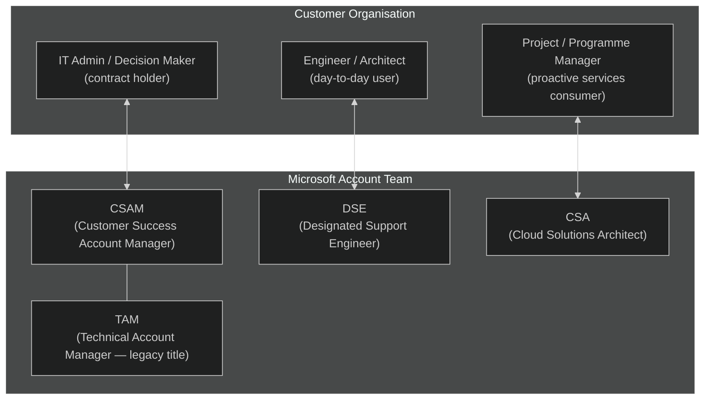
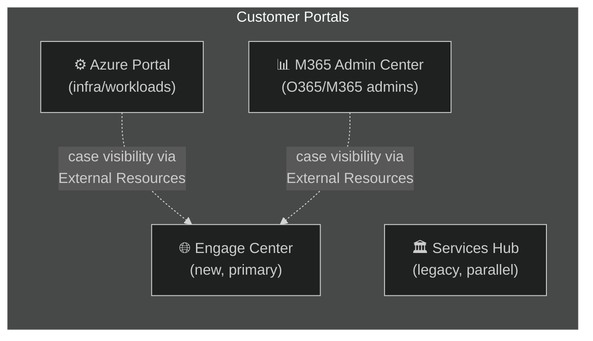
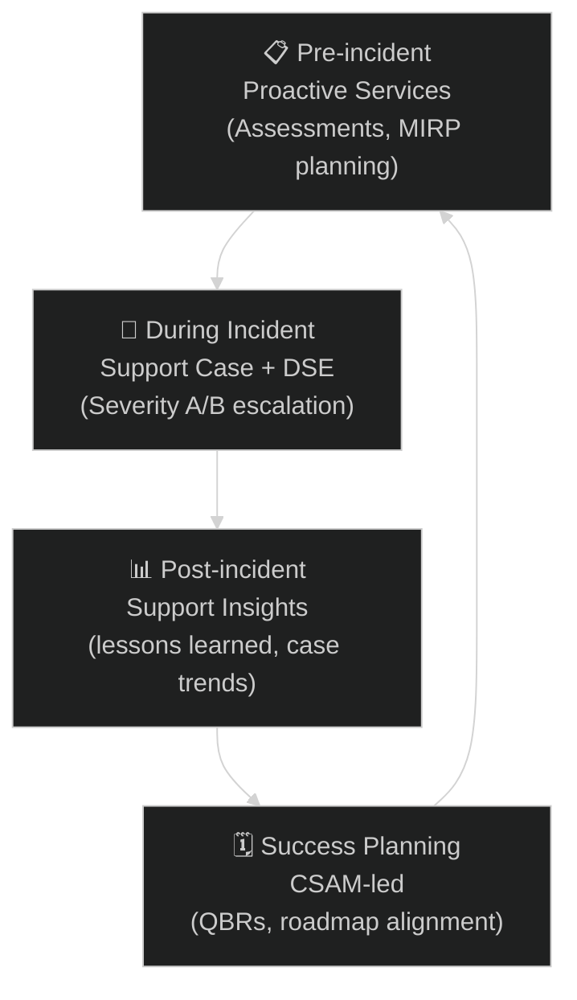

# 00 — Engage Center: Platform Overview
{: .no_toc }

> 📁 [← Back to Home](/engage-center-notes/)

  
Table of contents

  {: .text-delta }
1. TOC
{:toc}

---

## What Is Engage Center?

**Microsoft Engage Center** (`engagecenter.microsoft.com`) is the digital experience replacing Services Hub for organisations with a Microsoft enterprise support agreement such as **Microsoft Unified**. Built on Azure, it is the single destination for:

- Filing and tracking **support cases** (with the Support AI Assistant)
- Running **On-Demand Assessments** (self-service) and reviewing **Customer Activity** for agreement usage
- Maintaining the **Major Incident Response Plan (MIRP)** and **Incident Readiness** guidance
- Managing **users, roles, workspaces, and tenant visibility** (User Management, Manage Workspaces, External Resources)
- Consuming **learning** — on-demand courses and instructor-led Scheduled Services
- Viewing **Support Insights** on case trends, with AI-assisted Ask & Explore and Custom Reports

> **Key distinction:** Engage Center is not a new support *contract* — it is a new *portal experience* layered on top of existing Unified Support entitlements.

---

## Context & Rollout

Engage Center is part of Microsoft's broader initiative to modernise customer touchpoints following the **Unified Support rebrand** (which replaced Premier Support). Key milestones:

| Milestone | Detail |
|-----------|--------|
| **Premier → Unified transition** | New Premier contracts ceased; Microsoft Unified (Unified Enterprise Plan) launched |
| **Services Hub** | Web portal introduced as the primary interface for Unified customers |
| **Engage Center rollout** | Gradual and per customer — features move from Services Hub in a defined order (see [05](/engage-center-notes/05-services-hub-comparison/#official-rollout-phases)) |
| **Parallel operation** | Both portals remain active during transition; some features may still be accessed in Services Hub |
| **Final state** | Microsoft defines a point where all customers move fully to Engage Center and Services Hub is no longer accessed — no date published as of November 2026; check with your CSAM for your organisation's status |

> ⚠️ The rollout is phased. Not all features are available to all customers simultaneously. Check your account team for your organisation's migration timeline.

---

## Key Personas

Understanding who uses Engage Center helps you navigate the platform effectively.

| Persona | Role | Primary Engage Center Activity |
|---------|------|-------------------------------|
| **IT Admin** | Contract & licence management | Customer Activity (contract details), User Management |
| **Engineer / Architect** | Hands-on workload owner | Support cases, On-Demand Assessments, learning |
| **CSAM** | Relationship + success planning | MIRP maintenance, proactive service coordination |
| **DSE** | Deep technical escalation | Case collaboration, advisory |
| **CSA** | Solution architecture guidance | Assessment reviews, MIRP, technical advisory |

---

## Platform Positioning

Engage Center sits at the intersection of **reactive support** (cases) and **proactive success** (services, learning), acting as the primary lens through which customers consume their Unified Support investment.

---

## How Engage Center Fits the Support Lifecycle

The platform is designed to support **all four phases** of the support lifecycle, not just reactive case management.

---

## Access & Authentication

| Requirement | Detail |
|-------------|--------|
| **Who can access** | Users added to a workspace tied to an active support agreement |
| **Authentication** | Microsoft Entra ID organisational account. Direct Microsoft account (MSA) sign-in carried over from Services Hub is being retired — add MSA users as Entra guests |
| **User provisioning** | Customers manage their own users: workspace **Administrators** and **User Access Administrators** invite users and assign roles. CSAMs can only add administrators (in a Rollup workspace or via Manage Workspaces) — they can't add general users |
| **Tenant sign-in** | **External Resources → Login Access** must allow the user's tenant |
| **Conditional Access** | Engage Center can be targeted by Microsoft Entra Conditional Access policies — check yours allow access |
| **Network** | You may need to allow-list the Engage Center URLs — see the [connectivity guide](https://learn.microsoft.com/en-us/services-hub/microsoft-engage-center/support/engage-center-connectivity) |

> 💡 If you cannot access `engagecenter.microsoft.com`, ask your workspace Administrator or Customer Support Manager to invite you. Invited users show as **Pending** until their first sign-in.

---

## Key Terminology

| Term | Definition |
|------|-----------|
| **Unified Support** | Microsoft's current support contract model (replaced Premier) — officially branded **Microsoft Unified** / Unified Enterprise Plan; entitlements defined per individual agreement |
| **Premier Support** | Legacy contract model, still active for existing customers but no longer sold as new |
| **CSAM** | Customer Success Account Manager — your primary **Microsoft** relationship contact *(Microsoft employee)* |
| **CSM** | Customer Support Manager — the **customer-side** owner of the support agreement and administrator of the first workspace *(not to be confused with CSAM)* |
| **Incident Manager (IM)** | Microsoft system role with access to incident-related resources for incident coordination |
| **Managed Administrator** | Administrator of a child workspace, assigned and managed from the **Rollup** workspace |
| **Workspace / Rollup workspace** | A workspace scopes agreements, services, users, and cases; a Rollup aggregates several child Support Services workspaces |
| **DSE** | Designated Support Engineer — deep technical resource assigned under some contracts |
| **On-Demand Assessment** | Automated health check using Azure Log Analytics and the Engage Center Connector; assesses availability, security, and performance; part of the base Unified Enterprise plan |
| **Scheduled Services** | Instructor-led learning sessions and workshops within the Learning section of Engage Center (enrolment requested via your CSAM) — distinct from consulting/advisory proactive services |
| **MIRP** | Major Incident Response Plan — self-service portal tool in Engage Center for IR readiness |
| **Proactive Service** | Any Microsoft-delivered consulting or advisory service defined in your agreement (not a break-fix case or learning session) |
| **Severity** | Case business-impact level: **1** = critical (Unified Enterprise), **A** = critical impact, **B** = moderate, **C** = minimum |

---

## What's Next?

- 🧭 [01 — Navigation & Features](/engage-center-notes/01-navigation-features/) — UI walkthrough, how to find everything
- 📄 [03 — Unified & Premier Contracts](/engage-center-notes/03-unified-premier-contracts/) — understand your entitlements
- 🔄 [05 — Services Hub vs Engage Center](/engage-center-notes/05-services-hub-comparison/) — what moved, what hasn't

---

[← Back to Home](/engage-center-notes/) | [01 — Navigation & Features →](/engage-center-notes/01-navigation-features/)
