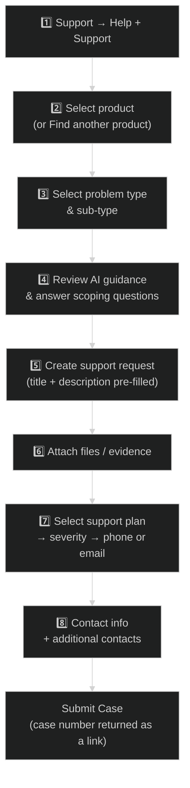
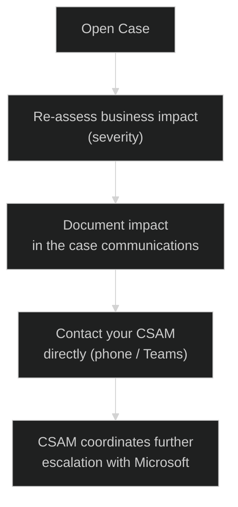

# 02 — Support Requests
{: .no_toc }

> 📁 [← Back to Home](/engage-center-notes/)

  
Table of contents

  {: .text-delta }
1. TOC
{:toc}

---

## Overview

The **Support** section of Engage Center is the primary interface for creating and managing break-fix support cases (also called **Support Requests**). It has two parts: **Help + Support**, where the Support AI Assistant guides self-help and case creation, and the **Support Requests** list, where you track and work on cases.

> 💡 Engage Center can also show support requests opened in Microsoft's cloud portals (for example the Azure portal), as long as the tenant's **Support Request Visibility** is turned on in **External Resources**.

---

## Severity Levels

Microsoft uses severity to set the initial response target. The Unified Enterprise targets published on the [Unified Enterprise plan details](https://www.microsoft.com/en-us/microsoft-unified/plan-details) page are:

| Severity | Business Impact | Initial Response (Unified Enterprise) |
|----------|----------------|-----------------|
| **Critical — Severity 1** | Mission-critical business system or production solution completely down; business at risk | **15 min for Azure / 1 hour for other products** (24x7) |
| **Severity A** | Critical business impact; significant loss or degradation of services | **1 hour** (24x7) |
| **Severity B** | Moderate business impact; work can continue in an impaired manner | **2 hours** (business hours by default; **24x7 only if requested** when the case is submitted) |
| **Severity C** | Minimum business impact; minor impediment of service | **4 hours** (business hours only) |

> ⚠️ These are **initial response** targets, not resolution time targets. Severity 1 and Severity A (and Severity B when 24x7 is selected) expect the customer to commit to continuous 24x7 engagement — otherwise Microsoft may lower the severity. Legacy Premier targets are in the [Response Target Reference](#response-target-reference) below. See [03 — Unified & Premier Contracts](/engage-center-notes/03-unified-premier-contracts/) for entitlement context.

---

## Case States

The Support Requests list tracks each case's **State** — for example **Active** or **Closed** — alongside its severity, product, product family, primary contact, and created date.

| Combination | What It Usually Means |
|-------------|----------------------|
| **High severity + Active** | Needs immediate attention |
| **High severity + Closed** | Recently resolved critical issue — review the communications history |
| **Low severity + Active** | Lower priority — monitor |
| **Older Active cases** | May be stalled — follow up |

> 💡 Use the **Communications** tab to see the conversation history with Microsoft support, and reply promptly when the engineer asks for information.

---

## Creating a New Support Request

### Step-by-Step (Support AI Assistant)

> 💡 After you pick a product, the assistant asks three **scoping questions**, and your answers are shared with the engineering team:
> - What problem are you encountering, including any error message or code?
> - When did you first notice the issue?
> - What recently changed in your environment, if anything?
>
> **Create support request** is shown prominently at the top of the page once you've answered them. If self-help resolves the issue, type something like "Issue resolved" and select **I'm done**. Use **Restart conversation** for a new topic, and **Phone support** to see regional phone numbers. Only users with the **Support User** role can create support cases, and cases can't be created from a **Rollup** workspace.

### Tips for a Strong Case Description

| Element | Best Practice |
|---------|--------------|
| **Title** | Be specific: "Azure VM cannot RDP after NSG change" not "VM issue" — edit the pre-filled title if needed |
| **Problem statement** | What is happening vs what is expected |
| **Impact** | How many users/systems affected, business consequence |
| **Steps to reproduce** | Numbered steps that reliably trigger the issue |
| **Recent changes** | Any deployments, config changes, updates before the issue started |
| **Error messages** | Exact text + any error codes |
| **Resource identifiers** | Tenant ID, subscription ID, resource group, resource name — whatever applies to the product |
| **Logs** | Attach relevant logs upfront |

---

## Working a Case

| Feature | Detail |
|---------|--------|
| **Overview** | Full case details |
| **Communications** | Conversation history with Microsoft support |
| **Attachments** | View files shared for troubleshooting; upload files requested by Microsoft support |
| **Sharing** | See who has access and share the request with colleagues |
| **Export** | Export the Support Requests list — reflects your current filters and the active workspace |

> 💡 You see cases you created, cases shared with you, and cases tied to your signed-in identity. Roles such as **Problem Manager** add visibility of all support requests in the workspace. In a **Rollup** workspace, **Case Assignment** routes unassigned cases to the right child workspace.

---

## Escalation

If resolution is unsatisfactory or urgency has increased:

### Escalation Paths

| Escalation Option | When to Use |
|------------------|-------------|
| **Re-assess severity** | Business impact has changed since the case was filed |
| **Document impact in the case** | Keep the business impact clear and current for the engineer |
| **Contact CSAM** | Most effective for critical cases — your CSAM coordinates escalation |

> 💡 Always **document the business impact** in the case when you escalate. This creates a clear record and helps Microsoft prioritise.

---

## Case Management Best Practices

| Practice | Rationale |
|----------|-----------|
| **Respond promptly to requests for information** | Keeps the investigation moving |
| **Share the request with stakeholders** | Keeps managers and architects informed without creating duplicate cases |
| **Include tenant / subscription / resource IDs at creation** | Prevents back-and-forth on basic identification |
| **One issue per case** | Mixed-issue cases are harder to route and track; open separate requests |
| **Reference prior cases** | If an issue recurs, mention the previous case number |
| **Check External Resources if a case is missing** | Cases only appear for tenants with Support Request Visibility turned on |

---

## Support for Specific Products

Routing is driven by the **product and problem type** you select in the Support AI Assistant, so choose the most specific product available (use **Find another product** if it isn't listed). Include the identifiers that apply to the product — for example the Azure subscription and resource IDs, the Microsoft 365 tenant ID, or the Dynamics 365 / Power Platform environment.

---

## Response Target Reference

| Contract | Severity 1 (Critical) | Severity A | Severity B | Severity C |
|----------|:----------:|:----------:|:----------:|:----------:|
| **Microsoft Unified (Enterprise)** | 15 min Azure / 1 h other (24x7) | 1 h (24x7) | 2 h (24x7 on request) | 4 h (business hours) |
| **Legacy Premier** | — | < 1 h (24x7) | < 2 h (24x7) | < 4 h |

> ⚠️ These are **initial response** targets, not resolution time targets. Resolution time varies by complexity and is not contractually guaranteed. Sources: [Unified Enterprise plan details](https://www.microsoft.com/en-us/microsoft-unified/plan-details) (Unified) and Microsoft's [Power BI support options](https://learn.microsoft.com/en-us/power-bi/support/service-support-options) page (Premier).

---

## Related

- 📄 [03 — Unified & Premier Contracts](/engage-center-notes/03-unified-premier-contracts/) — Microsoft Unified offering and entitlement context
- 🔄 [05 — Services Hub vs Engage Center](/engage-center-notes/05-services-hub-comparison/) — case creation differences
- ⚡ [06 — Cheatsheet](/engage-center-notes/06-cheatsheet/) — quick severity/SLA reference

---

[← 01 — Navigation & Features](/engage-center-notes/01-navigation-features/) | [03 — Unified & Premier Contracts →](/engage-center-notes/03-unified-premier-contracts/)
