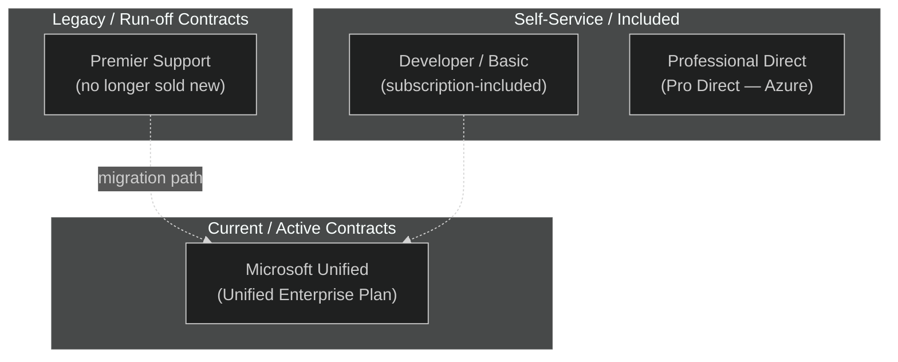
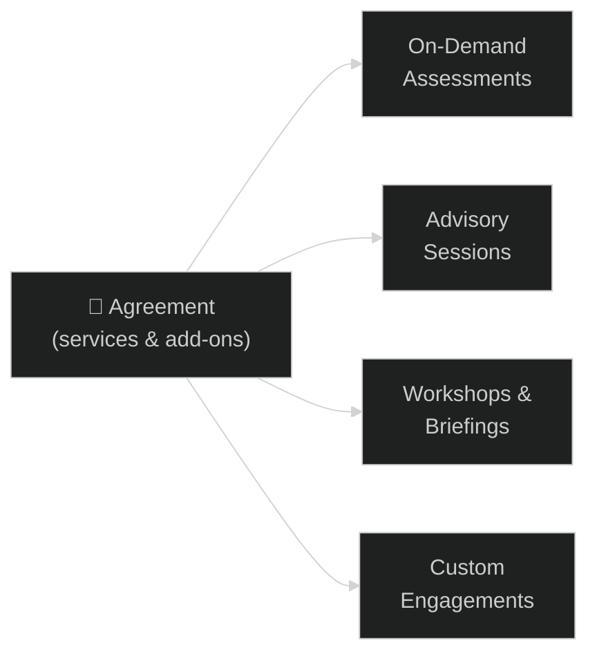

# 03 — Unified & Premier Contracts
{: .no_toc }

> 📁 [← Back to Home](/engage-center-notes/)

  
Table of contents

  {: .text-delta }
1. TOC
{:toc}

---

## Support Landscape Overview

Microsoft offers two broad support contract families to enterprise customers:

> ⚠️ **Premier Support is no longer sold** as a new contract. Existing Premier customers are being migrated to Unified Support. Some organisations retain legacy Premier terms until renewal.

---

## Microsoft Unified — Official Positioning

Microsoft's current enterprise support offering is marketed as **Microsoft Unified** (also referred to as the **Unified Enterprise Plan**). Based on the official [Unified Enterprise plan details](https://www.microsoft.com/en-us/microsoft-unified/plan-details):

| Attribute | Detail |
|-----------|--------|
| **Official brand name** | Microsoft Unified / Unified Enterprise Plan |
| **Included in the base plan** | Success management services (digital + **CSAM**), on-demand health assessments, problem resolution support (Sev 1 / A / B / C), services portal access, integrated technology support, on-demand learning, incident management services, billing & subscription support |
| **Optional add-ons** | **Mission Critical Services** (prioritised engineering engagement — preventative, proactive, and reactive services for business-critical workloads and major events) · **Value Acceleration Services** (plan, implement, and optimise priority Microsoft workloads) · **Unified Assured** (in-country technical support for local regulatory requirements) |
| **Entitlement model** | Individual negotiated contract — volumes of proactive services and add-ons are defined per agreement |
| **Portal** | Engage Center (`engagecenter.microsoft.com`) |
| **Predecessor** | Legacy Premier Support (no longer sold; migration to Unified at renewal) |

---

## Legacy Premier Support

Premier Support was Microsoft's previous flagship enterprise support contract. Key facts for CSAs:

| Attribute | Detail |
|-----------|--------|
| **Status** | No longer sold as new; existing contracts honoured until renewal/expiry |
| **Structure** | Annual contract with included Technical Account Manager (TAM) |
| **Cases** | Severity A / B / C response targets (Sev A < 1 h 24x7) — see [02 — Support Requests](/engage-center-notes/02-support-requests/#response-target-reference) |
| **Proactive services** | Premier Field Engineer (PFE)-delivered engagements |
| **Migration path** | Customers encouraged to migrate to Microsoft Unified at renewal |
| **Portal** | Services Hub (`serviceshub.microsoft.com`) — Engage Center access being extended |

### Premier vs Unified: Key Differences

| Dimension | Premier (Legacy) | Unified (Current) |
|-----------|:---------------:|:-----------------:|
| **Sold as new** | ❌ (discontinued) | ✅ |
| **Account manager** | TAM (Technical Account Manager) | CSAM (Customer Success Account Manager) |
| **Proactive delivery** | PFE-delivered engagements | Proactive services defined per agreement; optional Value Acceleration / Mission Critical add-ons |
| **Critical (Sev 1) tier** | ❌ | ✅ 15 min Azure / 1 h other products, 24x7 |
| **On-Demand Assessments** | ✅ (via Services Hub) | ✅ Included in the base plan |
| **Portal** | Services Hub | Engage Center (+ Services Hub during transition) |

> 💡 If you work with customers still on Premier, understand that their **TAM is functionally equivalent to a CSAM** and their **PFE engagements map to proactive services** in Unified. Migration conversations should focus on continuity, not disruption.

---

## Proactive Services Entitlements

Proactive services are non-break-fix services whose volume and scope are defined in your agreement.

> 💡 **Digital MIRP** is a self-service portal tool built into Engage Center — it is not a proactive service drawn from your agreement. See [04 — Digital MIRP](/engage-center-notes/04-digital-mirp/) for details.

| Service | Included in Microsoft Unified | Notes |
|---------|:-----------------------------:|-------|
| On-Demand Assessments | ✅ Base plan | Self-service via the Engage Center Connector + Azure Log Analytics; CSA-led delivery available |
| Advisory sessions | Contract-dependent | Scope defined in your agreement; coordinated through your CSAM |
| Workshops & Briefings | Contract-dependent | Scope defined in your agreement; instructor-led sessions surface under **Learning → Scheduled Services** |
| Custom engagements | Contract-dependent | e.g. via Value Acceleration or Mission Critical add-ons |
| On-demand learning | ✅ Base plan | **Learning → On-Demand Learning** |
| Digital MIRP (portal tool) | Role dependent | Requires the **Mirp Manager** or **Mirp Viewer** role |

> 💡 Service usage is shown in **Customer Activity** (Contract Manager role), not Support Insights. Each service tile shows its usage count and, where available, a detailed usage view.

---

## Contract Administration in Engage Center

| Task | Where in Engage Center |
|------|----------------------|
| View enterprise-wide and add-on packages for an agreement | **Customer Activity** (Agreement number dropdown) |
| View service usage counts & detailed usage | **Customer Activity** (Contract Manager role) |
| Choose which services show in a workspace | **Manage Agreements** (single workspace) or **Manage Workspaces** (from the Rollup workspace) |
| View Support Insights & case analytics | **Support Insights** (Reporting User or Problem Manager role) |
| Add/remove users and assign roles | **User Management** (users and Microsoft Entra groups) |
| Restrict which reactive support services a user or group can use | **User Management → Reactive Services** |
| Request contract amendment | Contact your CSAM directly |

> ⚠️ Navigation paths in Engage Center continue to evolve during the rollout. If a path has moved, refer to the [Engage Center documentation](https://learn.microsoft.com/en-us/services-hub/microsoft-engage-center/) or ask your CSAM.

---

## Common CSA Scenarios

### Scenario 1: Customer asks "What are we entitled to?"

> Navigate to **Customer Activity** in Engage Center (requires the **Contract Manager** role). Walk through the enterprise-wide package, any add-on packages, and the usage count on each service tile. Microsoft does not publish a fixed public entitlement breakdown — the customer's signed contract and their CSAM are the authoritative sources. Some services that can be turned on may not yet display in Customer Activity, so confirm anything missing with the CSAM.

### Scenario 2: Customer on Premier asks about migration to Unified

> Key points:
> - Unified Enterprise adds a **Critical (Sev 1)** tier — 15 min for Azure / 1 h for other products, 24x7 — above Severity A
> - Severity B is 2 h with **24x7 available on request**; Severity C is 4 business hours
> - On-Demand Assessments and on-demand learning are part of the base Unified Enterprise plan
> - Optional add-ons (Mission Critical, Value Acceleration, Unified Assured) cover needs that Premier handled through custom contracts
> - The portal experience moves from Services Hub to Engage Center

### Scenario 3: Customer wants to understand their support response times

> Unified Enterprise initial response targets: **Sev 1** — 15 min for Azure / 1 h for other products (24x7); **Sev A** — 1 h (24x7); **Sev B** — 2 h (24x7 only if requested at submission, otherwise business hours); **Sev C** — 4 business hours. For active incidents, the priority is opening the case at the correct severity in Engage Center. Proactive services, named resources, and add-ons are defined per the customer's agreement.

---

## Official Resources

| Resource | Link |
|----------|------|
| Microsoft Unified overview | [microsoft.com/microsoft-unified](https://www.microsoft.com/en-us/microsoft-unified) |
| Unified Enterprise plan details (severities, add-ons) | [Plan details](https://www.microsoft.com/en-us/microsoft-unified/plan-details) |
| Customer Activity (agreement usage) | [Customer Activity in Engage Center](https://learn.microsoft.com/en-us/services-hub/microsoft-engage-center/resources/customer-activity) |
| Engage Center roles | [Roles and permissions](https://learn.microsoft.com/en-us/services-hub/microsoft-engage-center/roles/) |
| Engage Center overview | [Engage Center overview](https://learn.microsoft.com/en-us/services-hub/microsoft-engage-center/get-started/) |

---

## Related Content

- 🎫 [02 — Support Requests](/engage-center-notes/02-support-requests/) — SLA reference by severity
- 🛡️ [04 — Digital MIRP](/engage-center-notes/04-digital-mirp/) — portal tool for IR readiness
- ⚡ [06 — Cheatsheet](/engage-center-notes/06-cheatsheet/) — quick reference for URLs, SLAs, and CSA tips

---

[← 02 — Support Requests](/engage-center-notes/02-support-requests/) | [04 — Digital MIRP →](/engage-center-notes/04-digital-mirp/)
