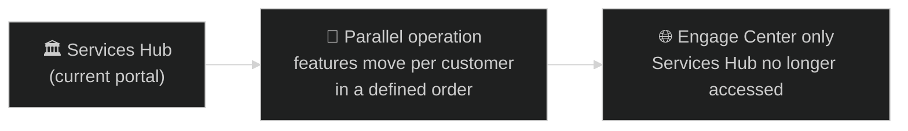
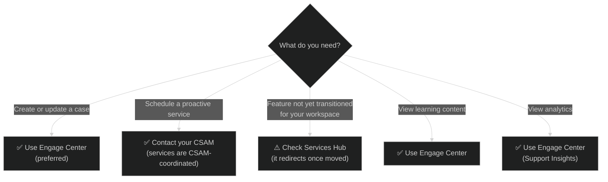

# 05 — Services Hub vs Engage Center
{: .no_toc }

> 📁 [← Back to Home](/engage-center-notes/)

  
Table of contents

  {: .text-delta }
1. TOC
{:toc}

---

## Overview

**Services Hub** (`serviceshub.microsoft.com`) has been the customer portal for Microsoft Unified (and Premier) support customers. **Engage Center** (`engagecenter.microsoft.com`) is the digital experience replacing it — built on Azure and rolling out gradually across Microsoft's customer base.

The two portals **run in parallel** during the transition period. The outcome is defined: **Engage Center becomes the single experience for daily support work**, and Services Hub redirects to it. Understanding what lives where during the transition is essential for CSAs advising customers.

---

## Migration Timeline

> ⚠️ Microsoft has not published a Services Hub retirement date (as of November 2026). The docs state there is "a defined point where all customers move fully to Engage Center" — but no date is given. Confirm the current status with your CSAM.

---

## Official Rollout Phases

Microsoft transitions features to Engage Center in a defined order. A customer's experience may be gradual (features appear over time) or faster-paced (multiple features shift within days). The official phase order is:

| Phase | Features Transitioning |
|-------|----------------------|
| **1 — Support foundations** | Case Create, Support Management |
| **2 — Everyday support context** | External Resources, Digital MIRP, Learning, Support Insights |
| **3 — Collaboration & artifacts** | Shared Files |
| **4 — Administration & structure** | Access Management, Space Management |
| **5 — Organisation & communications** | Customer Level Workspace, Newsletter, Customer Activity |
| **6 — On-Demand Assessments** | Assessments (last to transition) |

> 💡 Single Workspace customers generally receive features before Multiple Workspace customers. A feature is fully transitioned when it is end-to-end usable in Engage Center **and** no longer available in Services Hub (which redirects instead). Once you've fully transitioned, any activity you start in Services Hub redirects to Engage Center.

---

## Feature-by-Feature Comparison

**Legend:** ✅ available · ⚠️ partial / different model · ❌ not available · — no documented Services Hub equivalent

### Core Functionality

| Feature | Services Hub | Engage Center | Notes |
|---------|:-----------:|:-------------:|-------|
| **Create support case** | ✅ | ✅ | Engage Center uses the **Support AI Assistant** (guided self-help → scoping questions → case) |
| **View / update open cases** | ✅ | ✅ | **Support Requests** list with Overview, Communications, Attachments, Sharing tabs |
| **Share a case with colleagues** | ✅ | ✅ | **Sharing** tab on the case |
| **File attachments** | ✅ | ✅ | |
| **Phone support numbers** | — | ✅ | **Phone support** option in the Support AI Assistant |
| **Cases from cloud portals** | — | ✅ | Shown per tenant via **External Resources → Support Request Visibility** |
| **Case Assignment across workspaces** | — | ✅ | Rollup workspaces only |

### Proactive Services

| Feature | Services Hub | Engage Center | Notes |
|---------|:-----------:|:-------------:|-------|
| **Services catalogue / scheduling** | ✅ | ⚠️ CSAM-coordinated | Consulting/advisory services are scheduled through your CSAM |
| **On-Demand Assessments** | ✅ | ✅ | Last feature to transition (Phase 6) |
| **Agreement usage** | ✅ | ✅ | **Customer Activity** — packages, service tiles, usage counts (Phase 5) |
| **Digital MIRP** | ⚠️ Limited | ✅ Full | Fully digital in Engage Center (Phase 2) |
| **External Resources** | ❌ | ✅ | New in Engage Center (Phase 2) |
| **Shared Files** | ⚠️ | ✅ | Account team document sharing (Phase 3) |

### Account & Administration

| Feature | Services Hub | Engage Center | Notes |
|---------|:-----------:|:-------------:|-------|
| **View CSAM / account team** | ✅ | ✅ | MIRP → Your Account Team |
| **Manage org users** | ✅ | ✅ | Users and Microsoft Entra groups; User Access Administrator role |
| **Reactive Services (per-user/group service access)** | — | ✅ | Optional; via Settings → Features → Granular Reactive Services |
| **Manage Agreements / Manage Workspaces** | — | ✅ | Agreement-service associations; Rollup and child workspaces |
| **Newsletter** | — | ✅ | Subscriptions per user; distribution managed by admins (Phase 5) |

### Learning & Content

| Feature | Services Hub | Engage Center | Notes |
|---------|:-----------:|:-------------:|-------|
| **Learning paths / On-Demand Learning** | ⚠️ Basic | ✅ Full | Includes Microsoft Learn modules, learning paths, and hands-on labs; progress tracked |
| **Scheduled Services (instructor-led)** | — | ✅ | Browse sessions in Learning; request enrolment by emailing your CSAM |
| **My Learning** | ❌ | ✅ | Personalised progress view: Not Started / In Progress / Completed; assigned learning |
| **Learning Management** | ❌ | ✅ | Assign Microsoft Learn / Learning Campus courses, set due dates, track completion — requires Learning Manager role |

### Support Insights & Reporting

| Feature | Services Hub | Engage Center | Notes |
|---------|:-----------:|:-------------:|-------|
| **Case dashboards & filters** | ✅ | ✅ | Filters: State, Date range, Cloud, Product, Severity, Status, Tenant |
| **Initial Response (IR) met** | ⚠️ Basic | ✅ | Chart + Initial response performance statistic |
| **Critical case tracking** | ⚠️ Basic | ✅ | Critical cases and Critical case time statistics |
| **Cross-cloud case distribution** | ❌ | ✅ | Azure + M365 + other products in one view; by country/region too |
| **Ask & Explore (AI)** | ❌ | ✅ | Natural-language questions about support activity |
| **Custom Reports (AI)** | ❌ | ✅ | Templates (executive, SLA, CritSit, product health) or plain-language report requests |
| **Export** | ✅ | ✅ | Customer users only |

### Technical & Integration

| Feature | Services Hub | Engage Center | Notes |
|---------|:-----------:|:-------------:|-------|
| **SSO / Entra ID** | ✅ | ✅ | Direct MSA sign-in carried over from Services Hub is being retired |
| **Conditional Access** | ✅ | ✅ | Engage Center can be targeted by CA policies |
| **Multi-tenant support** | ✅ | ✅ | Managed in External Resources |

---

## What's Better in Engage Center

| Improvement | Detail |
|-------------|--------|
| **Guided case creation** | Support AI Assistant carries self-help context into the case (pre-filled title and description, scoping questions) |
| **Learning integration** | On-Demand Learning, Scheduled Services, My Learning progress tracking, and Learning Management for teams |
| **Support Insights** | Cross-cloud case analytics plus AI-assisted Ask & Explore and Custom Reports |
| **Digital MIRP** | Fully digital, self-service; replaces static PowerPoint decks |
| **External Resources** | Per-tenant control of case visibility, sign-in access, and MIRP availability |
| **User management** | Microsoft Entra group-based role management, plus optional per-user/group Reactive Services |
| **Workspaces** | Rollup workspaces with Managed Administrators and Case Assignment for complex organisations |
| **Customer Activity** | Centralised view of agreement packages, services, and usage |
| **Shared Files** | Account team can upload documents directly into the portal |

---

## What's Still Transitioning (as of November 2026)

Based on the official rollout order, features later in the phase sequence may still be in Services Hub for some customers:

| Feature | Rollout Phase | Status |
|---------|:------------:|--------|
| **On-Demand Assessments** | Phase 6 (last) | May still be in Services Hub |
| **Access Management & Space Management** | Phase 4 | May still be in Services Hub |
| **Newsletter & Customer Activity** | Phase 5 | May still be in Services Hub |
| **Customer Level Workspace** | Phase 5 | May still be in Services Hub |

> ⚠️ Feature availability varies by customer — some transition faster than others. When a feature has fully transitioned, Services Hub will **redirect** you to Engage Center rather than showing the feature there.

> 💡 If a customer says "I can't find X in Engage Center", check what phase that feature is in and whether Services Hub still shows it.

---

## Decision: Which Portal to Use?

**Default recommendation for CSAs:** Always start in **Engage Center**. Fall back to **Services Hub** only when the specific feature is confirmed not yet transitioned for that customer.

---

## URL & Access Reference

| Portal | URL | Primary Use (November 2026) |
|--------|-----|-------------------|
| **Engage Center** | `engagecenter.microsoft.com` | Primary portal for most workflows |
| **Services Hub** | `serviceshub.microsoft.com` | Legacy / fallback for features not yet transitioned |
| **Azure Portal** | `portal.azure.com` | Azure resource management; can raise Azure support cases here too |
| **M365 Admin Center** | `admin.microsoft.com` | M365/O365 admin; can raise M365 support cases |
| **Microsoft Support** | `support.microsoft.com` | Consumer/SMB support; also self-serve KB |

---

## Advising Customers on the Transition

### Common Customer Concerns

| Concern | Response |
|---------|----------|
| "Will I lose my case history?" | Cases assigned to the workspace — and cases from tenants with Support Request Visibility turned on in External Resources — appear in Engage Center. If something is missing, check the tenant toggle and workspace assignment first. |
| "My team is used to Services Hub — why change?" | Engage Center is replacing Services Hub; it adds guided case creation, AI-assisted Support Insights, and deeper learning integration. Services Hub stays available in parallel until your features transition. |
| "I can't find the service I was using in Services Hub" | Check the rollout phase for that feature. For consulting/advisory services, contact your CSAM — they're CSAM-coordinated. |
| "Our contract renews next month — should we wait?" | No — Engage Center access is based on your contract, not a separate sign-up. |

### Transition Checklist for CSAs

| Task | Done? |
|------|-------|
| Confirm the customer's Administrators have invited users and assigned roles (CSAMs can't add general users) | ☐ |
| Verify Engage Center URLs are allowlisted on customer firewall / proxy | ☐ |
| Confirm Conditional Access policies permit access to Engage Center | ☐ |
| Review **External Resources**: Support Request Visibility, Login Access, MIRP per tenant | ☐ |
| Walk through key sections in Engage Center with customer | ☐ |
| Verify open cases appear correctly in Support Requests | ☐ |
| Check which rollout phase the customer is on; identify features still in Services Hub | ☐ |
| Move any MSA-only users to Microsoft Entra guest accounts ahead of the MSA sign-in retirement | ☐ |
| Work with CSAM to remove unused Services Hub Workspaces | ☐ |
| Update bookmarks / shared links to point to Engage Center | ☐ |

---

## Official Resources

| Resource | Link |
|----------|------|
| Get ready for Engage Center | [Migration guide](https://learn.microsoft.com/en-us/services-hub/microsoft-engage-center/get-started/migration) |
| What to expect during rollout | [Rollout phases](https://learn.microsoft.com/en-us/services-hub/microsoft-engage-center/get-started/what-to-expect) |
| Engage Center features overview | [Features](https://learn.microsoft.com/en-us/services-hub/microsoft-engage-center/get-started/features) |
| Workspaces | [Engage Center workspaces](https://learn.microsoft.com/en-us/services-hub/microsoft-engage-center/get-started/workspaces) |
| Connectivity / allowlist guide | [Engage Center connectivity](https://learn.microsoft.com/en-us/services-hub/microsoft-engage-center/support/engage-center-connectivity) |

---

## Related Content

- 🌐 [00 — Platform Overview](/engage-center-notes/00-overview/) — Engage Center context
- 🧭 [01 — Navigation & Features](/engage-center-notes/01-navigation-features/) — Engage Center UI walkthrough
- ⚡ [06 — Cheatsheet](/engage-center-notes/06-cheatsheet/) — quick URL and feature reference

---

[← 04 — Digital MIRP](/engage-center-notes/04-digital-mirp/) | [06 — Quick Reference Cheatsheet →](/engage-center-notes/06-cheatsheet/)
